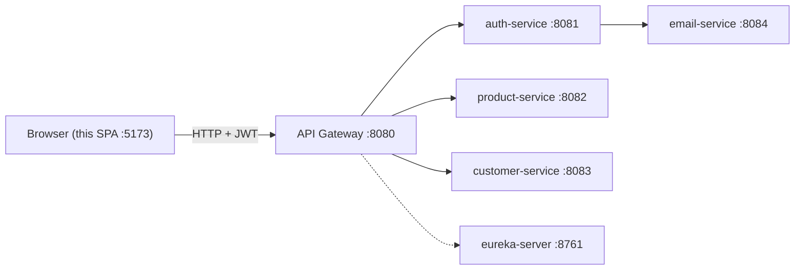

# E-Marketplace Storefront

React (Vite) single-page application for browsing a product catalog, managing a cart, placing orders, and running basic admin tasks. It talks to the **SecureAuth Enterprise Platform** backend **only through the API gateway** (default `http://localhost:8080`)—the same pattern a production client would use.

Branded in the UI as **E-Marketplace**; repository name remains `secureauth-storefront`.

---

## Table of contents

1. [What you will build](#what-you-will-build)
2. [Architecture](#architecture)
3. [Prerequisites](#prerequisites)
4. [Tutorial: run locally (development)](#tutorial-run-locally-development)
5. [Tutorial: run with Docker](#tutorial-run-with-docker)
6. [Walkthrough: first-time user journey](#walkthrough-first-time-user-journey)
7. [Configuration](#configuration)
8. [Project structure](#project-structure)
9. [Security model (frontend + backend)](#security-model-frontend--backend)
10. [Troubleshooting](#troubleshooting)

---

## What you will build

| Area | What the app does |
|------|-------------------|
| **Auth** | Register, log in, JWT stored in `localStorage` |
| **Catalog** | Product list, search, filters, product detail (INR pricing) |
| **Cart** | Client-side cart until checkout |
| **Orders** | Place order via gateway → product-service; view history |
| **Profile** | Link `customerId` when auth and customer services are separate |
| **Admin** | Create products/categories, low-stock restock (`ROLE_ADMIN`) |

The backend must be running first (Eureka, auth, customer, product services, API gateway). See the backend project README for `docker compose` and startup order.

---

## Architecture



| Port | Service | What it owns |
|------|---------|--------------|
| **8080** | api-gateway | Only URL this storefront calls (`VITE_API_BASE_URL`) |
| **8081** | auth-service | `/api/auth`, `/api/users` |
| **8082** | product-service | `/api/products`, `/api/categories`, `/api/orders` |
| **8083** | customer-service | `/api/customers`, including `GET /api/customers/me` |
| **8084** | email-service | OTP / notification mail |
| **8761** | eureka-server | Service discovery for the gateway |
| **5173** | storefront (Vite) | This React app in development |

- **Development:** Vite dev server (`npm run dev`, port **5173**) serves the app with hot reload.
- **Production (Docker):** Multi-stage image builds static files, then **nginx** serves them on port **80** (mapped e.g. to **8081** on the host).

Important: `VITE_API_BASE_URL` is read at **build time**. The value must be a URL your **browser** can reach (usually `http://localhost:8080` when the gateway runs on the host).

---

## Prerequisites

| Tool | Version (tested) | Purpose |
|------|------------------|---------|
| Node.js | 20.x LTS | Local dev & npm scripts |
| npm | 10+ | Dependencies |
| Docker | 24+ (optional) | Container image |
| Backend stack | — | Gateway on `:8080`, CORS allows frontend origin |

---

## Tutorial: run locally (development)

### Step 1 — Clone and install

```bash
cd secureauth-storefront
npm install
```

### Step 2 — Configure the API gateway URL

```bash
cp .env.example .env
```

Edit `.env` if the gateway is not on localhost:

```env
VITE_API_BASE_URL=http://localhost:8080
```

### Step 3 — Start the backend

From the backend repository (not this repo):

1. Start infrastructure (e.g. `docker compose up -d` for DBs/broker if applicable).
2. Start services in order: **eureka-server → auth-service → customer-service → product-service → api-gateway**.

Confirm the gateway responds, for example:

```bash
curl -s -o /dev/null -w "%{http_code}" http://localhost:8080/actuator/health
```

(Exact health path may differ; use whatever your gateway exposes.)

### Step 4 — Allow CORS for the dev origin

The gateway must allow `http://localhost:5173` in `globalcors` (or your dev port). If you change the Vite port, update CORS on the backend as well.

### Step 5 — Run the frontend

```bash
npm run dev
```

Open **http://localhost:5173**.

### Step 6 — Smoke test

1. **Register** a new account at `/register`.
2. You should land on **Products** after sign-up.
3. Open **Cart**, add items, **Place order** (requires linked `customerId`—set automatically after register on the same browser).

**Admin demo:** log in as seeded `admin` / `admin123` (if your backend provides it) to see **Admin** sidebar links.

---

## Tutorial: run with Docker

Docker packages a **production build** served by nginx. You do not get Vite hot reload inside the container.

### Step 1 — Build the image

From the project root:

```bash
docker build -t emarketplace-storefront:latest .
```

Point the built SPA at your gateway (browser-visible URL):

```bash
docker build \
  --build-arg VITE_API_BASE_URL=http://localhost:8080 \
  -t emarketplace-storefront:latest .
```

If users open the app from another machine, set `VITE_API_BASE_URL` to the gateway URL **those browsers** use (not `localhost` on the server unless they browse on the server itself).

### Step 2 — Run the container

```bash
docker run --rm -p 8081:80 emarketplace-storefront:latest
```

Open **http://localhost:8081**.

### Step 3 — Using Docker Compose (optional)

```bash
# Optional: export gateway URL for the build
export VITE_API_BASE_URL=http://localhost:8080

docker compose up --build
```

Default host port: **8081** (override with `STOREFRONT_PORT=3000 docker compose up`).

### Step 4 — CORS when using Docker

Browsers will send requests **from** `http://localhost:8081` (or your mapped port). Add that origin to the API gateway CORS configuration, same as for `:5173`.

### Rebuild when API URL changes

Because Vite embeds `VITE_*` at build time, changing the gateway URL requires **rebuilding** the image with a new `--build-arg VITE_API_BASE_URL=...`.

---

## Walkthrough: first-time user journey

1. **Sign up** (`/register`) — `AuthContext.register()` orchestrates:
   - `POST /api/auth/register`
   - `POST /api/auth/login`
   - `POST /api/customers/register`  
   The returned `customerId` is stored in `localStorage` keyed by username.

2. **Browse** (`/products`) — catalog loaded via shared `fetchProductCatalog()` (deduped for React StrictMode). Search and filters run client-side when the backend search endpoint is unavailable.

3. **Product detail** (`/products/:id`) — stock badges, add to cart.

4. **Cart** (`/cart`) — quantities and checkout. Checkout calls `POST /api/orders` with `{ customerId, items }`.

5. **Orders** (`/orders`, `/orders/:orderNumber`) — history and detail with INR formatting.

6. **Profile** (`/profile`) — manual `customerId` link if you log in on a new device (auth-service vs customer-service boundary).

7. **Admin** (`/admin/*`) — visible only when JWT roles include `ROLE_ADMIN`; backend still enforces `@PreAuthorize`.

### Why two IDs? (username vs `customerId`)

Identity (auth-service) and profile (customer-service) are separate microservices. Login proves who you are; it does not return a customer profile id. This app captures that id after registration or via the Profile page.

---

## Configuration

| Variable | Where | Description |
|----------|--------|-------------|
| `VITE_API_BASE_URL` | `.env` (dev) or Docker `build-arg` | Base URL for axios client (gateway) |
| `STOREFRONT_PORT` | Docker Compose | Host port mapped to container `80` (default `8081`) |

Example `.env`:

```env
VITE_API_BASE_URL=http://localhost:8080
```

---

## Project structure

```
secureauth-storefront/
├── Dockerfile              # Multi-stage: Node build → nginx
├── docker-compose.yml      # Optional one-service compose file
├── nginx/default.conf      # SPA fallback + static caching
├── .env.example
├── index.html
├── vite.config.js
└── src/
    ├── api/                # Gateway clients (auth, product, order, …)
    ├── constants/          # User-facing message strings
    ├── components/
    │   ├── common/         # Banners, dialogs, route guards, empty/loading
    │   ├── layout/         # Sidebar, Topbar, AppLayout, promo banner
    │   └── product/        # ProductCard, ProductFilters
    ├── context/            # AuthContext, CartContext
    ├── hooks/              # Sidebar, scroll, async helpers
    ├── pages/              # Route screens; admin/ for ROLE_ADMIN
    ├── styles/             # Auth-specific CSS
    └── utils/              # Currency, errors, product filters
```

### Scripts

| Command | Description |
|---------|-------------|
| `npm run dev` | Vite dev server (port 5173) |
| `npm run build` | Production bundle to `dist/` |
| `npm run preview` | Preview production build locally |

---

## Security model (frontend + backend)

- **JWT:** Attached as `Authorization: Bearer <token>` on every API call (`src/api/client.js`).
- **Errors:** Gateway `ErrorResponse` normalized to `friendlyMessage` for inline **ErrorBanner** components.
- **Routes:** `ProtectedRoute` / `AdminRoute` improve UX; real enforcement is on the backend.
- **No refresh token:** When the JWT expires (~1h per backend config), user signs in again.

---

## Troubleshooting

| Symptom | Likely cause | What to do |
|---------|----------------|------------|
| Blank catalog / network errors in DevTools | Gateway down or wrong `VITE_API_BASE_URL` | Verify gateway URL; rebuild Docker image if you changed the arg |
| CORS errors in browser console | Frontend origin not allowed | Add `http://localhost:5173` or `http://localhost:8081` to gateway CORS |
| Checkout says missing customer ID | No `customerId` in localStorage | Use Profile to link id, or register again on this browser |
| Docker build fails on `npm ci` | Lockfile out of sync | Run `npm install` locally and commit `package-lock.json` |
| 404 on refresh in Docker | Missing SPA fallback | Uses `try_files … /index.html` in `nginx/default.conf` (included) |
| Admin menu missing | User lacks `ROLE_ADMIN` | Log in as admin user from backend seed data |

---

## What is intentionally simplified

- Inline error banners per page (no global toast library).
- Cart state is in-memory until checkout (no persisted server cart).
- Hand-rolled CSS (`src/index.css`)—no component library—to keep dependencies small.

---

## License

Private / educational use alongside the SecureAuth Enterprise Platform backend. Adjust licensing to match your organization if you fork this repo.
