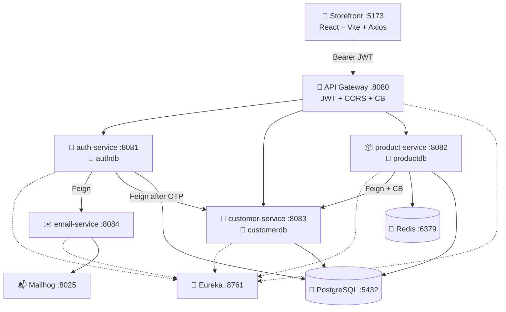

# 🛒🛡️ E-Marketplace

<p align="center">
  <strong>Full-stack commerce platform</strong><br/>
  React storefront + Spring Cloud JWT microservices — one gateway, many services.
</p>


<p align="center">
  
  
  
  
  
  
  
  
</p>

<p align="center">
  🔐 JWT at the edge <strong>and</strong> in every service &nbsp;·&nbsp;
  🐘 Database per service &nbsp;·&nbsp;
  ⚡ Circuit breakers &nbsp;·&nbsp;
  📧 Email OTP
</p>

The browser talks to **one** URL: the API gateway on `:8080`. Login, catalog, cart checkout, profile, and admin all go through that door.

| Half | Where | What it is |
|------|--------|------------|
| 🎨 **Storefront** | Companion UI (`frontend/` next to this repo, or [storefront](../../frontend)) | E-Marketplace SPA (Vite + React) |
| 🛡️ **Platform** | **This GitHub repo** | Eureka, gateway, auth, email, customer, product |

---

## 📑 Table of contents

1. [✨ Features](#-features)
2. [🧰 Tech stack — what & why](#-tech-stack--what--why)
3. [🏗️ Architecture](#️-architecture)
4. [📡 Ports](#-ports)
5. [⚡ Run the whole app](#-run-the-whole-app)
6. [🗺️ Storefront routes](#️-storefront-routes)
7. [🔌 API cheatsheet](#-api-cheatsheet)
8. [🧬 Domain model](#-domain-model)
9. [🔒 Security](#-security)
10. [🐳 Docker](#-docker)
11. [🩺 Troubleshooting](#-troubleshooting)

---

## ✨ Features

| 🎨 Storefront | 🛡️ Backend |
|---------------|-------------|
| 📝 Register → 📧 OTP → 🔑 login | Identity in **auth-service** (`authdb`) |
| 📦 Paginated catalog, search, INR | **product-service** + optional Redis |
| 🛍️ In-memory cart until checkout | Orders live with the catalog (not a separate service) |
| 👤 Profile via `GET /api/customers/details/by-email` | **customer-service** (`customerdb`) |
| 🛠️ Admin: product, category, restock | `@PreAuthorize("ROLE_ADMIN")` |
| 🧾 Order history | Feign call to customer-service + circuit breaker |

**Demo admin:** `admin` / `admin123` (seeded on the `dev` profile).  
**OTP inbox (local):** http://localhost:8025 (Mailhog)

---

## 🧰 Tech stack — what & why

Every library below is actually used in this repo. **What it is** = the idea. **Usage here** = where it shows up.

### 🎨 Frontend (`frontend/`)

| Tech | What it is | Usage in this app |
|------|------------|-------------------|
| ⚛️ **React 18** | UI library — components + hooks, not a full framework | Pages, layouts, `AuthContext`, `CartContext` |
| ⚡ **Vite 5** | Fast dev server + bundler | `npm run dev` on **:5173**; `vite.config.js` + `@vitejs/plugin-react` |
| 🧩 **React Router 6** | Client-side routes | `/login`, `/products`, `/cart`, `/profile`, `/admin/*` |
| 🌐 **Axios** | HTTP client | `src/api/client.js` — base URL = gateway; attaches `Authorization: Bearer` |
| 🎨 **MUI Icons + Material** | Icon set + a few widgets | Sidebar/product icons, `CircularProgress`, login `Backdrop` |
| 💅 **Emotion** | CSS-in-JS (MUI peer) | Used by MUI; app chrome is mostly `src/index.css` |
| 🧭 **React Context** | Built-in shared state | JWT session (`AuthContext`) and cart (`CartContext`) |
| 🐳 **nginx** | Static web server | Docker image serves `dist/` with SPA `try_files` fallback |

### ☕ Backend (this folder)

| Tech | What it is | Usage in this app |
|------|------------|-------------------|
| ☕ **Java 17** | Language + LTS runtime | All Spring Boot modules |
| 📦 **Maven** | Build + multi-module reactor | Parent POM `2.0.0` — one `mvn clean install` builds every service |
| 🌱 **Spring Boot 3.3** | App runtime (embedded Tomcat / Netty) | Each service is its own Boot app (`mvn spring-boot:run`) |
| ☁️ **Spring Cloud 2023.0** | Microservices toolkit | Eureka, Gateway, OpenFeign BOM in the parent POM |
| 📡 **Netflix Eureka** | Service registry | `:8761` dashboard; services register; gateway uses `lb://service-name` |
| 🚪 **Spring Cloud Gateway** | Reactive API gateway (WebFlux) | Public entry on **:8080**; routes `/api/auth`, `/api/customers`, `/api/products`, `/api/orders` |
| 🔐 **Spring Security** | Authn/authz filters | Stateless JWT; `permitAll` on login/register; `.authenticated()` elsewhere |
| 🎫 **JJWT 0.12** | Create / parse JWTs | `JwtUtil` issues tokens; gateway + each resource service **verify independently** (same secret) |
| 🗄️ **Spring Data JPA + Hibernate** | ORM | Entities, repositories, `ddl-auto: update` (dev only) |
| ✅ **Bean Validation** | `@Valid` / `@NotBlank` | Request DTOs on register, product create, addresses |
| 🩺 **Spring Actuator** | Health / ops endpoints | `/actuator/health`; gateway also exposes circuit-breakers |
| 🔗 **OpenFeign** | Declarative HTTP client | auth → email, auth → customer (after OTP), product → customer snapshot |
| ⚡ **Resilience4j** | Circuit breaker + retry | Product→customer Feign; gateway product/order routes + fallback |
| 🐘 **PostgreSQL 16** | Relational DB | **Three databases:** `authdb`, `productdb`, `customerdb` (never shared tables) |
| 🧊 **Redis 7 + Spring Cache** | In-memory cache | Catalog DTO cache-aside; **fail-open** if Redis is down |
| ✉️ **Spring Mail** | SMTP client | **email-service** only — OTP + welcome HTML templates |
| 📬 **Mailhog** | Fake SMTP + web inbox | Compose service; UI `:8025` so you can read OTPs |
| 📊 **Apache Spark 4.2** | Batch data job | `product-import-job` — ADMIN CSV import via `spark-submit` (optional) |
| 🧰 **Lombok** | Less boilerplate | `@RequiredArgsConstructor`, getters on entities |
| 🐳 **Docker + Compose** | Containers | Compose = Postgres + Redis + Mailhog; each service also has a Dockerfile |

### 🧠 Patterns (not libraries, still “tech”)

| Idea | What it is | Usage here |
|------|------------|------------|
| 🧩 **Database per service** | Each microservice owns its schema | Three DBs created in `docker/postgres-init/` |
| 🎫 **Defense in depth JWT** | Edge check + per-service verify | Gateway filter, then `JwtValidationFilter` on product/customer |
| 🧭 **API Gateway pattern** | One public URL for many services | Storefront sets `VITE_API_BASE_URL=http://localhost:8080` |
| 🧯 **Circuit breaker** | Stop calling a sick dependency | Stop customer-service → order Feign opens; fallback runs |
| 🎯 **Strategy (OCP)** | Swap algorithms without editing callers | `PricingStrategy` in product-service |
| 🧱 **Layered SOA** | Controller → Service → Repository | Every Boot module |

---

## 🏗️ Architecture



```text
Browser ──► :8080 gateway ──► auth / customer / product
                 ▲
                 └── discovers instances via Eureka :8761
```

---

## 📡 Ports

| Port | 🧩 Process | Who calls it |
|------|------------|----------------|
| **5173** | Vite storefront | You (browser) |
| **8080** | API gateway | **Only** URL the UI uses |
| **8081** | auth-service | Gateway `/api/auth` |
| **8082** | product-service | Products, categories, orders |
| **8083** | customer-service | `/api/customers` including `/details/by-email` |
| **8084** | email-service | auth-service only (not public) |
| **8761** | Eureka UI | Operators |
| **5432** | PostgreSQL | Services |
| **6379** | Redis | product-service (optional) |
| **8025** | Mailhog | Read OTP emails |

---

## ⚡ Run the whole app

### ✅ Prerequisites

| Tool | Version | For |
|------|---------|-----|
| ☕ JDK | 17+ | Backend |
| 📦 Maven | 3.9+ | Multi-module build |
| 🟢 Node.js | 20.x | Storefront |
| 🐳 Docker | 24+ | Postgres, Redis, Mailhog |
| 📊 Spark 4.2 at `/opt/spark` | optional | CSV import only |

### 1️⃣ Infra

```bash
cd secureauth-enterprise-platform
docker compose up -d
```

Creates `authdb`, `productdb`, `customerdb` + Redis + Mailhog.

### 2️⃣ Backend (this order, separate terminals)

```bash
mvn clean install -DskipTests

cd eureka-server    && mvn spring-boot:run
cd email-service    && mvn spring-boot:run
cd auth-service     && mvn spring-boot:run
cd customer-service && mvn spring-boot:run
cd product-service  && mvn spring-boot:run
cd api-gateway      && mvn spring-boot:run
```

Confirm http://localhost:8761 shows every service.

> ⚠️ **JWT secret** must be the **same** on gateway, auth, product, and customer. Login is public (no JWT check). Profile `/by-email` **does** check the token — a mismatch looks like “login works, profile 401”.

### 3️⃣ Storefront

```bash
cd frontend
npm install
cp .env.example .env          # VITE_API_BASE_URL=http://localhost:8080
npm run dev
```

Open **http://localhost:5173**.

| Script | What it does |
|--------|----------------|
| `npm run dev` | ⚡ Vite on 5173 |
| `npm run build` | 📦 Production bundle |
| `npm run preview` | 👀 Preview `dist/` |

---

## 🗺️ Storefront routes

| Path | 🔒 | Screen |
|------|----|--------|
| `/login` `/register` `/verify-email` `/forgot-password` | Public | Auth |
| `/products` `/products/:id` `/categories` | Signed in | Catalog |
| `/cart` | Signed in | Cart + checkout |
| `/orders` `/orders/:orderNumber` | Signed in | Orders |
| `/profile` | Signed in | Loads `GET /api/customers/details/by-email` |
| `/admin/*` | `ROLE_ADMIN` | Catalog ops |

---

## 🔌 API cheatsheet

All public traffic → **`http://localhost:8080`**.

```bash
# Public — no JWT
curl -X POST http://localhost:8080/api/auth/register  -H "Content-Type: application/json" -d '{...}'
curl -X POST http://localhost:8080/api/auth/verify-email -d '{"email":"...","otp":"..."}'
curl -X POST http://localhost:8080/api/auth/login -d '{"username":"...","password":"..."}'

# After login
curl -H "Authorization: Bearer $TOKEN" \
  "http://localhost:8080/api/customers/details/by-email?email=you@example.com"

curl "http://localhost:8080/api/products?page=0"
curl -X POST http://localhost:8080/api/orders \
  -H "Authorization: Bearer $TOKEN" -H "Content-Type: application/json" \
  -d '{"customerId":1,"items":[{"productId":1,"quantity":2}]}'
```

| UI client | Gateway path |
|-----------|----------------|
| `authApi` | `/api/auth/*` |
| `productApi` | `/api/products`, `/low-stock`, restock |
| `categoryApi` | `/api/categories` |
| `orderApi` | `/api/orders` |
| `customerApi` | `/api/customers/details/by-email`, register, addresses |

---

## 🧬 Domain model

**📦 productdb**

```text
Category (tree)
   └── Product ── 1:1 ── Inventory
         └── OrderItem ── N:1 ── Order  (customerId is a Long, not a cross-DB FK)
```

**👤 customerdb**

```text
Customer ── 1:N ── Address
       └── 1:1 ── ContactDetail
```

`Customer.email` lines up with `User.email` in auth-service. No shared tables.

---

## 🔒 Security

- 🚪 Gateway `JwtAuthenticationFilter` — open: `/api/auth/*`, `/api/customers/register`, catalog **GET**s
- 🛡️ product-service + customer-service **re-verify** the same `jwt.secret`
- 🎨 Axios adds `Bearer` from `localStorage.sa_token`
- 🧭 React `ProtectedRoute` is UX only — the API is the real gate
- ⏳ JWT ~1 hour, no refresh token
- 🔑 Same `jwt.secret` on **all four** JWT-aware processes (or signed-in APIs return 401)

---

## 🐳 Docker

**Infra (day-to-day):** `docker compose up -d` in this folder.

**Storefront image:**

```bash
cd frontend
docker build --build-arg VITE_API_BASE_URL=http://localhost:8080 -t emarketplace-storefront .
docker run --rm -p 8081:80 emarketplace-storefront
```

**Service images** (build context = this folder):

```bash
docker build -f eureka-server/Dockerfile    -t secureauth/eureka-server .
docker build -f api-gateway/Dockerfile      -t secureauth/api-gateway .
docker build -f auth-service/Dockerfile     -t secureauth/auth-service .
docker build -f email-service/Dockerfile    -t secureauth/email-service .
docker build -f product-service/Dockerfile  -t secureauth/product-service .
docker build -f customer-service/Dockerfile -t secureauth/customer-service .
```

---

## 🩺 Troubleshooting

| 😕 Symptom | 💡 Cause | ✅ Fix |
|------------|----------|--------|
| Login 200, profile **401** | Gateway JWT secret ≠ auth-service | Same `jwt.secret`, **restart api-gateway** |
| Blank catalog | Gateway down / wrong `VITE_API_BASE_URL` | Hit `:8080`; rebuild UI if the URL changed |
| Login 403 “verify email” | OTP not confirmed | Mailhog **:8025** |
| Checkout missing `customerId` | Profile never linked | Open Profile (`/by-email`) once |
| Empty Eureka | Start order | Eureka **first** |
| Import 500 | No Spark | Install `/opt/spark` or skip import |
| `React is not defined` | Vite without React plugin | `frontend/vite.config.js` + `npm install` |

---

<p align="center">
  🚀 Infra → services → storefront &nbsp;·&nbsp; 🧡 private / educational demo
</p>
